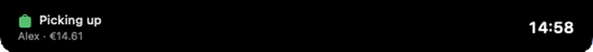
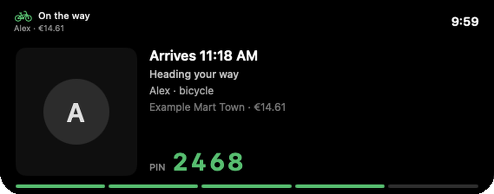
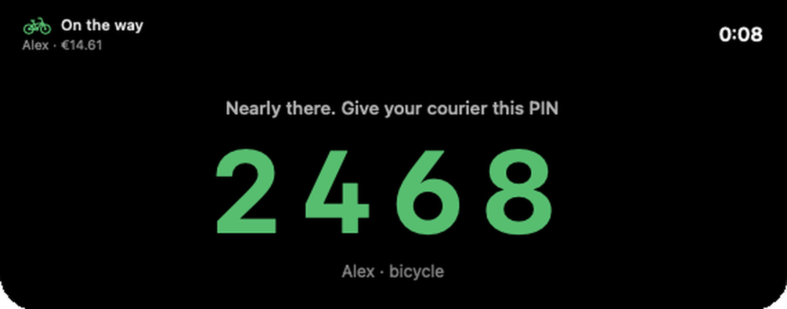
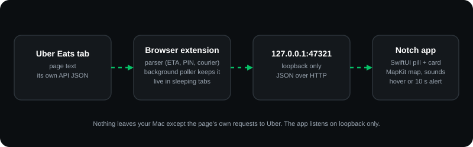

# Notch Eats

A live Uber Eats tracker for the MacBook notch. Order, switch to YouTube or work in another tab, and the notch tells you when your food is close, shows who is bringing it, and drops down the delivery PIN in huge digits when the courier is about 10 seconds away.

<p align="center">
  
</p>

> The animation uses made-up data. It loops through: collapsed pill, hover card, PIN drop-down, delivered tick.

## What you get

| | |
|---|---|
| **Always-on pill** | Status, courier name, order value and a live `m:ss` countdown, hugging the notch. Hidden when there is no order. |
| **Hover card** | Arrival window, headline, courier (name, vehicle, plate, Top-rated), store and total, PIN, Uber's 5-step progress bar, a mini map. |
| **PIN drop-down** | About 10 seconds out (or the page says "Arriving", or the courier is within about 80 m) it pings, drops the card down and shows the PIN big. It closes again if the ETA moves later. |
| **Status alerts** | A chime and a short drop-down when the order moves on, for example when the courier leaves the store. |
| **Delivered** | An Apple Pay style circle-and-tick animation with the system's payment success sound. |
| **Works in the background** | The extension keeps polling the order in its background worker, so it stays live when the tab is hidden, asleep or closed. |

<p align="center">
  <br><br>
  
  
</p>

<p align="center"></p>

## How it works

<p align="center"></p>

1. **`extension/`** is a Manifest V3 browser extension for Chromium browsers (Chrome, Comet, Brave, Edge). It reads the Uber Eats tracking page, understands the wording with `parse.js`, and watches the JSON the page already downloads for courier positions (`hook.js`). The background worker (`background.js`) replays the page's own order request about every 10 seconds, so the tab does not need to stay awake.
2. It posts small JSON updates to **`127.0.0.1:47321`**, where the notch app listens. The listener is pinned to loopback, so other devices on your network cannot reach it.
3. **`app/NotchEats.swift`** is a single-file SwiftUI/AppKit menu-bar app. It draws the pill and card in a click-through window at the notch, renders the map with MapKit, and plays the sounds.

## Install

Requirements: a Mac with a notch, macOS 14 or later, Xcode command line tools (`xcode-select --install`), a Chromium browser.

```bash
git clone https://github.com/lefotugrapher/notch-eats.git
cd notch-eats
./build.sh --run      # build and launch once
./install.sh          # optional: install to ~/Applications and start at every login
```

Then load the extension:

1. Open `chrome://extensions` (Comet: `comet://extensions`) and switch on **Developer mode**.
2. Click **Load unpacked** and choose the `extension/` folder.
3. Open your Uber Eats order tracking page once. After that you can leave it.

The extension popup shows what it last read, whether the app was reached, and whether background polling is on. The bag icon in the menu bar has **Demo order** (hover the notch) and **Quit**.

To remove the login item: `./install.sh --uninstall`.

## Privacy and safety

- Nothing is sent anywhere except from your own browser to Uber (as the page already does) and to the local app on loopback.
- The delivery PIN only appears in the expanded card, so it is not on screen during a screen share unless you hover or the courier is about to arrive.
- The app never asks for or stores your Uber credentials. Background polling reuses your existing browser session, like the page itself.

## Limitations (please read)

- **Unofficial.** Not affiliated with or endorsed by Uber. Uber has no public customer API, so this reads the page text and the page's own requests. Uber can change either at any time and break parsing. The regexes in `extension/parse.js` are the first place to look.
- Built and tested against one person's orders (grocery and food, Ireland, English, Comet browser). Other regions, languages and order types may word things differently.
- "10 seconds away" is an estimate. Uber gives minutes, not seconds, so the alert uses the countdown, the "Arriving" status, or courier distance when map coordinates are available.
- Map coordinates come from guessing which JSON fields hold the courier and drop-off positions. The popup lists every coordinate path it saw, to help correct the guess.
- Background polling replays Uber's own request. If Uber needs a header the extension did not capture, polling fails and the popup says why; the tab-based reading still works.

## Develop

```bash
node extension/parse.test.js       # parser tests (fixtures use made-up names and PINs)
curl 127.0.0.1:47321/state          # last payload the extension sent
NOTCH_PORT=47322 ./build/NotchEats.app/Contents/MacOS/NotchEats   # test copy on another port
```

PRs welcome, especially page-wording fixes for other regions.

## License

[MIT](LICENSE)
